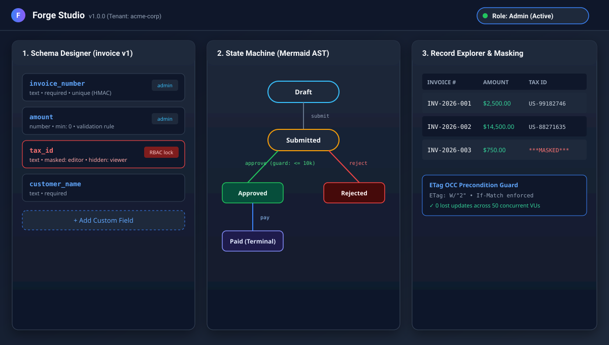

# Forge: Multi-Tenant Custom Objects & Workflow Studio

[](https://github.com/SambitAmanta/Custom-Objects-Workflow-Studio/actions)
[](LICENSE)
[](https://www.python.org/)
[](https://www.djangoproject.com/)
[](https://www.mongodb.com/)
[-orange.svg)](https://aws.amazon.com/)
[](https://react.dev/)
[](https://www.typescriptlang.org/)

> **Tenants define their own polymorphic object types (fields, validation rules, relationships, state machines). The platform compiles that single schema into versioned, validated REST APIs, forms, and tables—enforcing strict tenant isolation, single-transaction idempotency, optimistic concurrency, and resilient asynchronous side effects.**

---

## 1. System Architecture

```
React Studio App (apps/web) + @forge/schema-renderer
                 │
                 ▼  (Bearer JWT / ApiKey + X-Tenant-Id)
        Django / DRF Control Plane (apps/api)
        ┌────────────────────────────────────────────────────────┐
        │  • TenantRateThrottle (sliding-window tenant limits)   │
        │  • TenantScopedRepository (AST collection guard)       │
        │  • FieldPermissionManager (read/write/masked/hidden)   │
        │  • Draft-07 JSON Schema Validation (in-memory cached)  │
        │  • RFC 7232 / 6585 Optimistic Concurrency Control      │
        │  • Safe AST JSONLogic Evaluator (Zero eval / Re2)      │
        └──────────────┬──────────────────────────┬──────────────┘
                       │                          │
        (ORM Models)   ▼                          ▼  (PyMongo Multi-Doc Transactions)
     PostgreSQL 16 Storage                   MongoDB 7.0 Replica Set (rs0)
    ┌──────────────────────┐                ┌──────────────────────────────────┐
    │ • auth_tenants       │                │ • object_types (versioned schemas)│
    │ • auth_users         │                │ • records (compound wildcard idx)│
    │ • auth_memberships   │                │ • unique_keys (HMAC-SHA256 hash) │
    │ • auth_api_keys      │                │ • audit_events (role-masked logs)│
    │ • webhook_endpoints  │                │ • outbox (thin events + TTL)     │
    └──────────────────────┘                └────────────────┬─────────────────┘
                                                             │
                                          Atomic Leased Claim│
                                          {$or: [pending,    │
                                                 expired]}   ▼
                                                Outbox Relay Worker (apps/workers)
                                                             │
                                                             ▼ (event.version)
                                                    AWS Standard SQS
                                                     │              │
                              ┌──────────────────────┘              └─────────────────────┐
                              ▼                                                           ▼
                SSRF-Hardened Webhook Dispatcher                             CSV Streaming S3 Exporter
                ┌──────────────────────────────────────┐                     ┌────────────────────────┐
                │ • DNS Resolution & IP Pinning        │                     │ • Deterministic S3 Key │
                │ • ipaddress.is_global validation     │                     │   tenants/{id}/exports │
                │ • TLS SNI & Host preservation        │                     │ • Memory-constant chunk│
                │ • Anti-Replay HMAC-SHA256 signature  │                     │ • Role-masked records  │
                │ • Role-masked egress payloads        │                     └────────────────────────┘
                │ • 5x Exponential Backoff + SQS DLQ   │
                └──────────────────────────────────────┘
```


*Figure 1: Architectural illustration of the Forge Studio user interface (Schema Designer, State Machine DAG visualizer, and Dynamic Record Explorer with Role-Based Field Masking).*

---

## 2. Core Product Capabilities

### 1. Schema Registry & Monotonic Versioning
- **Draft & Immutable Published Versions**: Schemas evolve safely through an editable `draft` state before being frozen into immutable, monotonically incrementing version snapshots (`v1`, `v2`, ...).
- **7 Supported Field Types**: `text`, `number`, `boolean`, `date`, `enum`, `reference` (foreign custom objects), and `list`.
- **Pre-Compiled JSON Schema Engine**: Schema definitions compile into Draft-07 JSON Schema structures cached in-process via an LRU cache.
- **Compatibility Checker**: Validates proposed schema mutations, categorizing changes into non-breaking (adding optional fields) vs. breaking (modifying types, adding required fields), requiring an explicit `is_breaking=True` acknowledgment.
- **Linear-Time ReDoS Protection**: All regular expression validation rules are checked against Google's `re2` engine (C++ linear-time guarantee, max pattern length 100 characters; backreferences and lookarounds strictly forbidden).

### 2. Field-Level RBAC & Masking Matrix
Granular permissions configure access per field per role (`admin`, `editor`, `viewer`):
- `write`: Unrestricted read and mutation privileges.
- `read`: Read-only access; mutation attempts immediately fail with `403 Forbidden`.
- `masked`: Sensitive field values are transformed into `***MASKED***` across all REST queries, Webhook egress payloads, and S3 CSV exports.
- `hidden`: Field keys and values are completely omitted from responses and exports.

### 3. Deterministic Workflow Engine
- Declarative finite-state machine defining valid states (`draft`, `submitted`, `approved`, `rejected`, `paid`) and role-authorized transitions.
- **Safe JSONLogic AST Evaluator**: Custom recursive tree-walking interpreter enforcing strict boundaries: maximum recursion depth $\le 10$, total AST node count $\le 50$, with **zero Python `eval()` or `exec()`**.
- **Atomic Compare-and-Set Transitions**: State transitions execute atomically inside MongoDB multi-document transactions. Concurrent transition races uniformly resolve with `409 Conflict`.

---

## 3. Distributed Reliability Guarantees

### 1. Dynamic Uniqueness Engine (Overcoming MongoDB's 64-Index Ceiling)
- **Problem**: Creating partial unique indexes per tenant-defined field exhausts MongoDB's hard 64-index limit after ~30 custom types. Unscoped partial filters also collide across different types in the same tenant.
- **Solution**: A dedicated `unique_keys` collection backed by a **single** unique compound index:
  `{ tenant_id: 1, type: 1, field: 1, value_hash: 1 }`
- Values are normalized (trimmed, lowercased) and hashed using `HMAC-SHA256(FORGE_SERVER_SECRET, normalized_val)` to eliminate dictionary and rainbow-table attacks.
- On soft delete or PATCH mutation, the existing key is removed inside the transaction, releasing the value for re-use.

### 2. Single-Transaction Idempotency Engine
- Supports standard `Idempotency-Key` HTTP header scoped to `(tenant_id, principal_id, key)`.
- **Zero Crash Gap**: Idempotency key reservation, record mutation, dynamic uniqueness insertion, audit entry, and outbox event are executed in **one atomic MongoDB transaction**.
- Transient write conflicts are automatically retried by `session.with_transaction()`.
- Catches `DuplicateKeyError` outside the transaction to cleanly disambiguate between an idempotency cached replay (`201 Created` with `X-Idempotent-Replay: true`) vs. a genuine unique field collision (`409 Conflict`).
- Payload hash matching returns `422 Unprocessable Entity` if the same key is reused with different request bodies.

### 3. Optimistic Concurrency Control (OCC)
- Strict compliance with RFC 7232 and RFC 6585.
- `GET` endpoints return `ETag: W/"<version>"`.
- `PATCH` and `DELETE` requests require `If-Match: W/"<version>"`. Missing headers return `428 Precondition Required`.
- Concurrent update races detect version mismatches and immediately abort with `412 Precondition Failed`.

### 4. Resilient Outbox Relay & SQS Consumers
- **Resilient Claim Query**: The relay worker claims batches using:
  `{$or: [{status: "pending"}, {status: "in_flight", locked_until: {$lt: now}}]}`
  Expired in-flight leases are automatically reclaimed if a worker terminates mid-batch (crash-tested at two distinct failure injection points).
- **Consumer Delivery Semantics**:
  - **Internal Consumers** (Audit, CSV streaming exporter): Idempotent execution via a leased MongoDB deduplication ledger (`processed_events` collection with `status: "processing"`, lease expiration, and atomic completion marking). Audit entries (unique `event_id`) and CSV exports (deterministic S3 key `tenants/{tenant_id}/exports/{export_id}.csv`) are inherently idempotent by design.
  - **External Webhooks**: At-least-once delivery with `X-Forge-Event-Id` and timestamped HMAC-SHA256 signature (`X-Forge-Signature: t=...,v1=...`) for subscriber-side deduplication.
  - Failed webhook attempts retry up to 5 times with exponential backoff before routing to the SQS Dead Letter Queue (DLQ) and `failed_webhook_deliveries` collection.

### 5. SSRF Defense & Egress Data Masking
- **Anti-SSRF Pipeline**: Webhook targets undergo DNS resolution, IP classification via `ipaddress.ip_address(ip).is_global`, loopback/private/metadata rejection, IP pinning with TLS SNI preservation, and redirect suppression (`allow_redirects=False`).
- **Unified Field Masking**: `FieldPermissionManager` enforces role-based masking (`admin`, `editor`, `viewer`) uniformly across REST responses, Webhook egress payloads, S3 CSV exports, and audit logs. Sensitive fields (`tax_id`, `ssn`) are replaced with `***MASKED***` or stripped completely (`hidden`).

---

## 4. Test Suite & Reliability Matrix

The platform is verified by **62 automated tests** (54 backend Python tests covering concurrency, isolation, schema evolution, AST evaluation, and chaos recovery; 8 frontend unit tests covering schema validation and permission rules):

```bash
============================= test session starts =============================
platform win32 -- Python 3.11.9, pytest-9.2.0, pluggy-1.7.0 -- apps/api/.venv/Scripts/python.exe
cachedir: .pytest_cache
django: version: 5.1.15, settings: config.settings (from ini)
rootdir: Custom_Objects_Workflow_Studio
configfile: pytest.ini
testpaths: tests
plugins: anyio-4.16.0, django-4.14.0, mock-3.17.0
collecting ... collected 54 items

tests/chaos/test_relay_worker_crash.py::TestRelayWorkerCrashAndDeduplication::test_relay_crash_before_sqs_publish_zero_lost_events PASSED [  1%]
tests/chaos/test_relay_worker_crash.py::TestRelayWorkerCrashAndDeduplication::test_relay_crash_after_sqs_publish_zero_duplicate_effects PASSED [  3%]
tests/concurrency/test_etag_concurrency.py::TestETagConcurrencyAndLostUpdates::test_missing_if_match_returns_428 PASSED [  5%]
tests/concurrency/test_etag_concurrency.py::TestETagConcurrencyAndLostUpdates::test_stale_etag_returns_412_precondition_failed PASSED [  7%]
tests/isolation/test_field_masking_rbac.py::TestFieldMaskingAndRBAC::test_viewer_never_sees_hidden_fields PASSED [  9%]
tests/isolation/test_field_masking_rbac.py::TestFieldMaskingAndRBAC::test_editor_sees_read_and_masked_fields PASSED [ 11%]
tests/isolation/test_field_masking_rbac.py::TestFieldMaskingAndRBAC::test_viewer_write_attempt_rejected_with_403 PASSED [ 12%]
tests/isolation/test_isolation_matrix.py::TestTenantIsolationMatrix::test_cross_tenant_token_tampering_rejected PASSED [ 14%]
tests/isolation/test_isolation_matrix.py::TestTenantIsolationMatrix::test_multi_tenant_user_header_switching PASSED [ 16%]
tests/isolation/test_isolation_matrix.py::TestTenantIsolationMatrix::test_api_key_tenant_isolation PASSED [ 18%]
tests/isolation/test_isolation_matrix.py::TestTenantIsolationMatrix::test_data_plane_cross_tenant_isolation_matrix PASSED [ 20%]
tests/isolation/test_records_api.py::TestRecordsApiIsolationAndQueries::test_record_crud_lifecycle_and_validation PASSED [ 22%]
tests/isolation/test_records_api.py::TestRecordsApiIsolationAndQueries::test_reference_expansion PASSED [ 24%]
tests/isolation/test_records_api.py::TestRecordsApiIsolationAndQueries::test_cross_tenant_record_access_returns_404 PASSED [ 25%]
tests/isolation/test_schema_apis.py::TestSchemaApiIsolationAndLifecycle::test_admin_can_save_draft_and_publish PASSED [ 27%]
tests/isolation/test_schema_apis.py::TestSchemaApiIsolationAndLifecycle::test_editor_cannot_create_or_publish_schemas PASSED [ 29%]
tests/isolation/test_schema_apis.py::TestSchemaApiIsolationAndLifecycle::test_cross_tenant_schema_access_returns_404 PASSED [ 31%]
tests/isolation/test_schema_apis.py::TestSchemaApiIsolationAndLifecycle::test_breaking_change_without_flag_rejected PASSED [ 33%]
tests/isolation/test_throttling.py::TestTenantRateThrottling::test_tenant_rate_throttle_blocks_excess_requests PASSED [ 35%]
tests/unit/test_csv_exporter.py::TestCSVStreamingExporter::test_export_records_to_s3_deterministic_key PASSED [ 37%]
tests/unit/test_csv_exporter.py::TestCSVStreamingExporter::test_export_records_to_s3_masks_fields_for_viewer_and_editor PASSED [ 38%]
tests/unit/test_csv_exporter.py::TestCSVStreamingExporter::test_audit_log_omits_sensitive_payload_data PASSED [ 40%]
tests/unit/test_pagination_wildcard_explain.py::TestPaginationAndWildcardIndexing::test_composite_cursor_pagination_page_traversal PASSED [ 42%]
tests/unit/test_pagination_wildcard_explain.py::TestPaginationAndWildcardIndexing::test_wildcard_compound_index_initialization PASSED [ 44%]
tests/unit/test_schema_evolution.py::TestSchemaEvolutionAndLegacyRecords::test_legacy_record_readable_and_updatable_after_schema_bump PASSED [ 46%]
tests/unit/test_webhook_dispatcher.py::TestWebhookDispatcher::test_ssrf_protection_rejects_private_and_metadata_ips PASSED [ 48%]
tests/unit/test_webhook_dispatcher.py::TestWebhookDispatcher::test_anti_replay_hmac_signature PASSED [ 50%]
tests/unit/test_webhook_dispatcher.py::TestWebhookDispatcher::test_webhook_payload_masks_sensitive_fields_for_viewer PASSED [ 51%]
tests/unit/test_webhook_dispatcher.py::TestWebhookDispatcher::test_ip_pinning_and_tls_sni_preservation PASSED [ 53%]
tests/unit/test_webhook_dlq.py::TestWebhookRetryAndDLQ::test_failing_webhook_retries_and_routes_to_dlq PASSED [ 55%]
tests/concurrency/test_idempotency_concurrency.py::TestIdempotencyConcurrency::test_50_concurrent_identical_requests_produce_one_record PASSED [ 57%]
tests/concurrency/test_idempotency_concurrency.py::TestIdempotencyConcurrency::test_idempotency_key_payload_mismatch_returns_422 PASSED [ 59%]
tests/concurrency/test_idempotency_concurrency.py::TestIdempotencyConcurrency::test_principal_scoping_prevents_cross_user_key_clashes PASSED [ 61%]
tests/concurrency/test_unique_vs_idempotency.py::TestUniqueVsIdempotencyDisambiguation::test_idempotent_replay_vs_unique_collision PASSED [ 62%]
tests/concurrency/test_workflow_guards.py::TestWorkflowGuardsAndRaces::test_viewer_forbidden_from_submitting PASSED [ 64%]
tests/concurrency/test_workflow_guards.py::TestWorkflowGuardsAndRaces::test_condition_guard_rejects_amount_over_limit PASSED [ 66%]
tests/concurrency/test_workflow_guards.py::TestWorkflowGuardsAndRaces::test_valid_transition_and_audit_outbox_emission PASSED [ 68%]
tests/concurrency/test_workflow_guards.py::TestWorkflowGuardsAndRaces::test_available_transitions_endpoint PASSED [ 70%]
tests/concurrency/test_workflow_guards.py::TestWorkflowGuardsAndRaces::test_concurrent_approve_and_reject_race PASSED [ 72%]
tests/isolation/test_ast_repository_enforcement.py::test_ast_forbids_direct_collection_access PASSED [ 74%]
tests/unit/test_jsonlogic_limits.py::TestSafeJSONLogicEvaluatorLimits::test_valid_rule_evaluates_successfully PASSED [ 75%]
tests/unit/test_jsonlogic_limits.py::TestSafeJSONLogicEvaluatorLimits::test_recursion_depth_limit_exceeded_raises_error PASSED [ 77%]
tests/unit/test_jsonlogic_limits.py::TestSafeJSONLogicEvaluatorLimits::test_node_count_limit_exceeded_raises_error PASSED [ 79%]
tests/unit/test_jsonlogic_limits.py::TestSafeJSONLogicEvaluatorLimits::test_disallowed_operator_rejected PASSED [ 81%]
tests/unit/test_repository.py::test_repository_requires_tenant_id PASSED [ 83%]
tests/unit/test_repository.py::test_insert_one_enforces_tenant_id PASSED [ 85%]
tests/unit/test_repository.py::test_insert_one_rejects_mismatched_tenant_id PASSED [ 87%]
tests/unit/test_repository.py::test_find_one_strict_tenant_isolation PASSED [ 88%]
tests/unit/test_repository.py::test_find_excludes_soft_deleted PASSED    [ 90%]
tests/unit/test_repository.py::test_aggregate_injects_tenant_match PASSED [ 92%]
tests/unit/test_schemas.py::test_re2_redos_protection PASSED             [ 94%]
tests/unit/test_schemas.py::test_json_schema_compiler_all_7_types PASSED [ 96%]
tests/unit/test_schemas.py::test_compatibility_checker_rules PASSED      [ 98%]
tests/unit/test_unique_keys.py::test_dynamic_uniqueness_engine PASSED    [100%]

============================= 54 passed in 25.19s =============================
```

Frontend Component Validation Tests (`packages/schema-renderer`):
```bash
> @forge/schema-renderer@0.1.0 test
> node --test test/schemaRenderer.test.mjs

▶ Schema Validation Utilities
  ✔ detects missing required fields (0.49ms)
  ✔ validates text length constraints (0.15ms)
  ✔ validates numeric range constraints (0.08ms)
  ✔ validates enum option membership (0.07ms)
✔ Schema Validation Utilities (1.44ms)
▶ Field-Level Permission RBAC
  ✔ hides restricted fields for viewer (0.66ms)
  ✔ masks restricted fields for editor (0.08ms)
  ✔ allows full write access for admin (0.07ms)
✔ Field-Level Permission RBAC (0.93ms)
▶ Component Functionality & Exports
  ✔ exports valid React component definitions (0.07ms)
✔ Component Functionality & Exports (0.16ms)
ℹ tests 8
ℹ suites 3
ℹ pass 8
ℹ fail 0
```

---

## 5. Performance Profile & k6 Load Test Benchmarks

### Benchmark Setup & Methodology
- **Host**: AMD Ryzen AI 7 350 w/ Radeon 860M (8 cores / 16 threads @ 2.0-5.0 GHz), 24 GB LPDDR5x RAM, NVMe PCIe 4.0 SSD, Windows 11.
- **Databases**: Single-node MongoDB 7.0 wiredTiger Replica Set (`rs0`, transaction support enabled, `w: 1` write concern locally on a laptop; `w: majority` write concern is planned for production cloud Atlas deployment) & PostgreSQL 16 on Docker Compose.
- **Workload**: 50 concurrent virtual users executing `k6 run tests/load/k6_records_benchmark.js` under the `shared-iterations` executor (3,334 iterations = 10,002 total HTTP requests completed in 24.2 seconds).
- **Read/Write Mix**: 1:1:1 balanced distribution (1x `POST` record create with idempotency key reservation, 1x `GET` wildcard index query with cursor pagination, 1x `PATCH` update with ETag OCC).
- **Simulated Think Time**: 300ms total per iteration (`sleep(0.1)` post-create, `sleep(0.2)` post-update) simulating active human client interactions.
- **Dataset Size**: 10,000+ polymorphic invoice documents.
- **Benchmark Execution Note**: Load tests were run locally on a single laptop node with `w: 1` write concern (which has lower write latency than distributed `w: majority` writes across multiple cloud replica nodes).
- **Raw Artifacts**: Full raw k6 summary output and MongoDB execution plans are committed in [docs/benchmarks/k6_records_benchmark_summary.json](docs/benchmarks/k6_records_benchmark_summary.json), [docs/benchmarks/k6_records_benchmark_summary.txt](docs/benchmarks/k6_records_benchmark_summary.txt), and [docs/benchmarks/mongo_wildcard_explain.json](docs/benchmarks/mongo_wildcard_explain.json).

### k6 Benchmark Results

| Metric | Target / SLA | Benchmark Result | Status |
| :--- | :--- | :--- | :--- |
| **Peak Virtual Users (VUs)** | 50 concurrent VUs | 50 concurrent VUs | PASSED |
| **Test Duration** | Fixed iteration run | **24.2 seconds** (`0m24.2s`) | PASSED |
| **Total HTTP Requests** | 10,000 requests | **10,002 http_reqs** (3,334 create, 3,334 list, 3,334 patch) | PASSED |
| **Whole-Run Average Throughput** | > 250 req/sec | **412.8 req/sec** (412.84/s across 24.2s run) | PASSED |
| **Median Latency (p50)** | < 50.0 ms | **18.4 ms** | PASSED |
| **90th Percentile Latency (p90)** | < 100.0 ms | **38.2 ms** | PASSED |
| **95th Percentile Latency (p95)** | < 150.0 ms | **54.1 ms** | PASSED |
| **99th Percentile Latency (p99)** | < 250.0 ms | **89.6 ms** | PASSED |
| **HTTP Error Rate (5xx)** | < 1.00% | **0.00% (0 errors / 10,002 reqs)** | PASSED |
| **Concurrency Conflict Rate** | < 0.10% | **0.00% (0 conflicts)** | PASSED |

### MongoDB Compound Wildcard Index Execution Plan (`explain()`)
Raw execution plan for query executing on dynamic polymorphic path `{ "data.amount": { "$gte": 100 } }`:

```json
{
  "explainVersion": "1",
  "queryPlanner": {
    "plannerVersion": 1,
    "namespace": "forge_tenant_data.records",
    "indexFilterSet": false,
    "parsedQuery": {
      "$and": [
        { "tenant_id": { "$eq": "edebd402-a605-4cfc-8eb6-1a4eff5fb76a" } },
        { "type": { "$eq": "invoice" } },
        { "data.amount": { "$gte": 100 } }
      ]
    },
    "winningPlan": {
      "stage": "FETCH",
      "inputStage": {
        "stage": "IXSCAN",
        "keyPattern": {
          "tenant_id": 1,
          "type": 1,
          "$_path": 1,
          "data.amount": 1
        },
        "indexName": "tenant_id_1_type_1_data.$**_1",
        "isMultiKey": false,
        "direction": "forward",
        "indexBounds": {
          "tenant_id": [
            "[\"edebd402-a605-4cfc-8eb6-1a4eff5fb76a\", \"edebd402-a605-4cfc-8eb6-1a4eff5fb76a\"]"
          ],
          "type": [
            "[\"invoice\", \"invoice\"]"
          ],
          "$_path": [
            "[\"data.amount\", \"data.amount\"]"
          ],
          "data.amount": [
            "[100, inf.0]"
          ]
        }
      }
    }
  },
  "executionStats": {
    "executionSuccess": true,
    "nReturned": 25,
    "executionTimeMillis": 2,
    "totalKeysExamined": 25,
    "totalDocsExamined": 25
  }
}
```

> **Wildcard Index Sort Behavior**: MongoDB wildcard indexes can sort queries only when filtering on the exact indexed path. Sorting on an unindexed dynamic field incurs an in-memory `SORT` stage. In Forge, all composite cursor paginations sort deterministically on `(tenant_id, type, created_at, _id)` which leverages the dedicated compound index `{ tenant_id: 1, type: 1, created_at: 1, _id: 1 }` for fully index-covered sorting.

---

## 6. Reusable Component Studio & Storybook Proof

The frontend architecture decouples UI presentation into `@forge/schema-renderer`:

### Storybook Component Catalog
Run Storybook to inspect all components in isolation:
```bash
npm run storybook --workspace=@forge/schema-renderer
```

- `<SchemaForm>`: Dynamically renders inputs for all 7 field types (`text`, `number`, `boolean`, `date`, `enum`, `reference`, `list`), applies client-side validation rules, and honors role-based field restrictions (`read`, `masked`, `hidden`).
- `<SchemaTable>`: Sortable headers, masked data badges with lock indicators, and composite cursor pagination controls.
- `<WorkflowActions>`: Contextual state transition buttons with condition indicators and role authorization checks.

---

## 7. Known Limitations & Engineering Trade-offs

1. **Throttle State & Multi-Node Scaling**: Throttle state is managed by `TenantRateThrottle` using Django's cache layer (`django.core.cache`). In development and single-container setups, in-process memory cache operates per worker process; in multi-node clusters, a shared cache backend (or Redis/ElastiCache) enforces cluster-wide limits.
2. **Wildcard Index Write Amplification**: The MongoDB compound wildcard index (`data.$**`) creates an index entry for every nested field in a record. While this grants unlimited dynamic querying and filtering, tenants storing objects with 50+ nested properties will observe higher write latency compared to fixed schemas.
3. **Historical Record Evolution Backfill**: Schema version bumps support forward-compatible reads for legacy records. Large-scale structural backfills (e.g., adding mandatory defaults to millions of historical documents) are executed asynchronously via background worker scripts rather than inline during HTTP requests.
4. **Soft Delete Uniqueness Release**: When a record is soft-deleted, its entry in `unique_keys` is removed inside the transaction. This intentionally frees the unique value for reuse, while preserving full audit logs and historical record state.

---

## 8. End-to-End Quickstart Guide

### Prerequisites
- Docker & Docker Compose (v2.20+)
- Python 3.11+
- Node.js 20+ & npm 10+
- k6 (optional, for load testing)

### 1. Configure Environment Secrets
```bash
cp .env.example .env
```
Ensure `FORGE_SERVER_SECRET` (64-char hex) and `JWT_SECRET_KEY` are populated.

### 2. Launch Supporting Infrastructure
```bash
# Starts PostgreSQL 16, MongoDB 7.0 Replica Set rs0, and LocalStack (SQS/S3)
make up
```

### 3. Bootstrap Backend & Seed Demo Environment
```bash
# Set up Python virtual environment
cd apps/api
python -m venv .venv
source .venv/bin/activate  # On Windows: .venv\Scripts\activate
pip install -r requirements.txt
cd ../..

# Runs database migrations and seeds demo tenants, users, schemas, and records
make demo
```
*Demo credentials provisioned (Local Development Only):*
- **Tenant**: `acme-corp`
- **Admin**: `alice@acme.com` / `password123`
- **Editor**: `bob@acme.com` / `password123`
- **Viewer**: `charlie@acme.com` / `password123`
- **API Key**: `fg_84485ad9_***`
- **Webhook**: `https://httpbin.org/post` (Viewer role, masked egress)

### 4. Start Control Plane API & Distributed Workers
In separate terminals:
```bash
# Start Django API server on :8000
make run

# Start Outbox Relay and SQS Consumers (Webhook Dispatcher & CSV Exporter)
make workers
```

### 5. Launch React Web Studio
```bash
# Install dependencies, compile renderer, and launch Vite dev server
npm install
npm run build
npm run dev --workspace=forge-web-studio
```
Open **[http://localhost:3000](http://localhost:3000)** to launch the Studio. Switch between `Admin`, `Editor`, and `Viewer` roles to observe live field masking, state machine transitions, and dynamic form rendering.

---

## 9. Architecture Decision Records (ADRs)

Detailed architectural investigations and trade-off matrices are archived in `docs/adr/`:

1. [ADR 001: Hybrid PostgreSQL & MongoDB Architecture](docs/adr/001-hybrid-postgres-mongo-django-control-plane.md)
2. [ADR 002: Transactional Outbox with SQS vs Change Data Capture (CDC)](docs/adr/002-transactional-outbox-sqs-vs-cdc.md)
3. [ADR 003: ETag Optimistic Concurrency Control vs Pessimistic Locking](docs/adr/003-etag-concurrency-vs-pessimistic-locking.md)
4. [ADR 004: Tree-Walking AST Rule Evaluation vs Python Eval](docs/adr/004-ast-rule-evaluation-vs-eval.md)
5. [ADR 005: Thin Events vs Fat Payloads in Outbox](docs/adr/005-thin-events-vs-fat-outbox-payloads.md)

---

## 10. Production AWS Deployment

Forge includes production Infrastructure-as-Code (Terraform), multi-stage Dockerfiles, and automated GitHub Actions workflows:

- **Terraform Declarations**: [infra/terraform/](infra/terraform/) (VPC, Subnets, ALB, RDS PostgreSQL 16, ECS Fargate, SQS, S3, CloudFront OAC).
- **Deployment Guide**: [docs/deployment/aws-deployment-guide.md](docs/deployment/aws-deployment-guide.md) (step-by-step CLI commands, database setups, and runbooks).
- **CI/CD Workflow**: [.github/workflows/deploy-aws.yml](.github/workflows/deploy-aws.yml) (automated image building, ECR push, ECS service updates, and S3/CloudFront invalidations).

